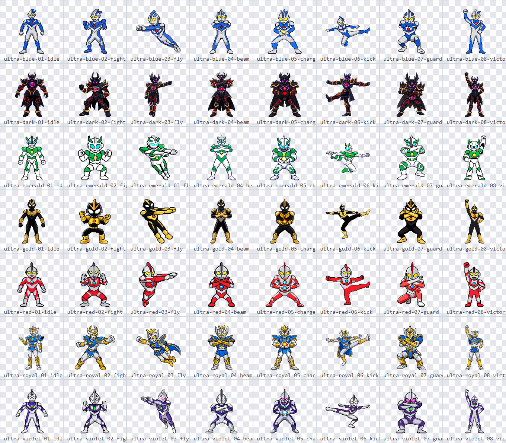
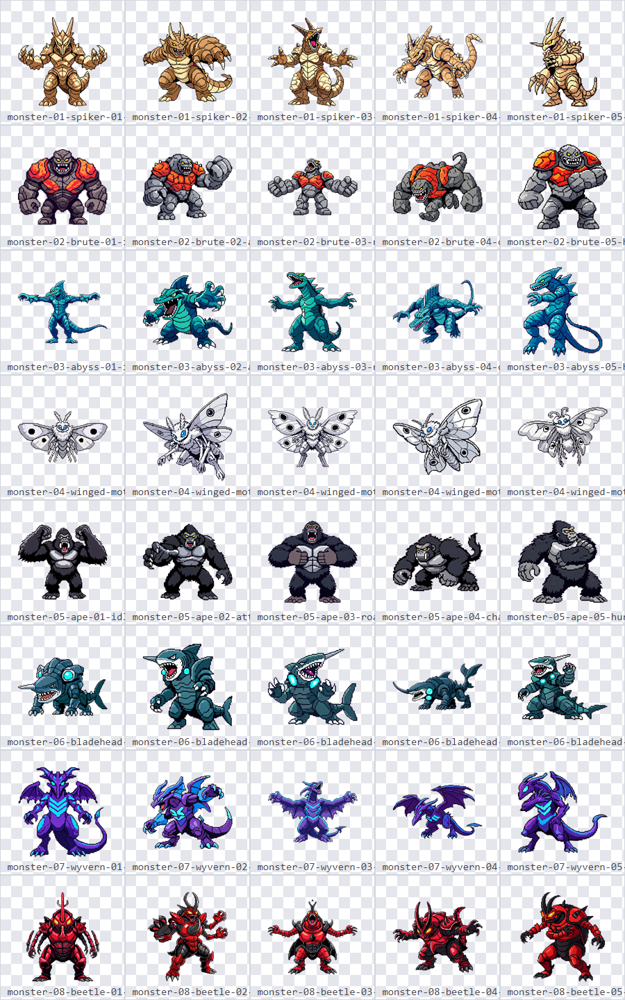

# 算术超能战

面向小学二年级以上孩子的算术对战闯关游戏，运行在 **FoloToy AI Passport**（ESP32-C3）上。把口算题变成攻击手段：答对出招、抓准暴击、蓄满必杀，最后和 Boss 对拼光线。

- 目标硬件：ESP32-C3 · 8 MB Flash · 无 PSRAM · 240 × 320 ST7789P3 · 3 个按键
- 开发框架：ESP-IDF 5.5.3 + LVGL 9.5（复用仓库 BSP，界面全部重新设计）
- 界面语言：简体中文（内置 12 / 14 / 20 / 28 px 子集字体）
- 存档：NVS `battle_v1`，保存解锁进度、星级、最高分、英雄、难度和静音状态

<p align="center">
  
  
</p>

## 游戏内容

### 四种模式

| 模式 | 解锁条件 | 玩法 |
| --- | --- | --- |
| 闯关 | 默认开放 | 8 关战役，前两关带教程，终点是 Boss 光线对拼 |
| 无尽 | 通关第 1 关 | 连续作战，波间可以选择收手或继续，继续时分数加成 +10% |
| 三连战 | 通关第 5 关 | 第 6~8 关连续三场，血量与分数继承，中途不重置 |
| 限时 | 通关第 2 关 | 60 秒连续答题，答错扣 3 秒，连击越高怪兽干扰越强 |

### 限时猎手

限时模式把每一秒都变成分数：答对得分，连击越高单题得分越高。随着连击上升，
怪兽会开始干扰选项：

| 连击 | 干扰 |
| --- | --- |
| 4 连 | 烟雾遮住一个选项，只显示 `??` |
| 8 连 | 冰冻一个选项，要按两次 OK 才能作答 |
| 12 连 | 怪兽把三个选项换位 |

低龄模式会关闭全部干扰，并把题目降低一档。最佳分数保存在本地并显示在首页模式卡片上。

### 收藏与成就

设置里的「收藏图鉴」分为英雄、怪兽、徽章三页：

- **英雄图鉴**：首次使用某位英雄出战时收录。
- **怪兽图鉴**：首次遭遇某只怪兽时收录。
- **徽章**：达成条件后永久保留。

| 徽章 | 条件 |
| --- | --- |
| 无伤通关 | 满血通过任意一关 |
| 连击高手 | 单局打出 8 连击 |
| 无尽五战 | 无尽模式到达第 5 关 |
| 全关制霸 | 打通全部 8 关 |
| 限时猎手 | 限时模式得分达到 300 |
| 三星收藏 | 8 关全部拿到 3 星 |

### 八关战役

| 关卡 | 怪兽 | 数学范围 | 题目时间 | 怪兽血量 |
| --- | --- | --- | --- | --- |
| 街区警报 | 巴尔坦星人 | 20 以内加减 · 2~5 乘法 | 8.0 s | 4 |
| 重装对决 | 雷德王 | 20 以内加减 · 2~5 乘法 | 7.8 s | 4 |
| 深海来袭 | 雷伊洛斯 | 100 以内加减 · 6~9 乘法 | 7.0 s | 5 |
| 夜翼危机 | 多拉考 | 100 以内加减 · 6~9 乘法 | 6.8 s | 5 |
| 森林巨兽 | 哥莫拉 | 退位减 · 乘除 · 填空 | 6.2 s | 6 |
| 钢刃追猎 | 加拉特隆 | 退位减 · 乘除 · 填空 | 6.0 s | 6 |
| 赤甲虫王 | 杰顿 | 混合两步 · 100 以内加减 | 5.6 s | 7 |
| 终焉飞龙 | 魔格大蛇 | 混合两步 · 乘除 · 填空 | 5.2 s | 8（Boss） |

### 七位英雄

| 英雄 | 被动 |
| --- | --- |
| 赛罗奥特曼 | 必杀槽获取 +25% |
| 泰罗奥特曼 | 暴击伤害 +1 |
| 泰迦奥特曼·光子地球 | 每题答题时间 +0.8 秒 |
| 泽塔奥特曼·德尔塔天爪 | 暴击判定区 +30% |
| 迪迦奥特曼 | 每关首次受伤免疫 |
| 贝利亚奥特曼 | 暴击伤害 +1 |
| 捷德奥特曼·尊皇 | 每关首次受伤免疫 |

### 三档难度

| 难度 | 节奏 | 生命 | 怪兽强度 | 暴击区 |
| --- | --- | --- | --- | --- |
| 星光 | 时间 +31.5 秒 · 数学 -1 档 | 5 颗心 | -1 血 | 50 |
| 烈焰 | 标准节奏 | 4 颗心 | 标准 | 40 |
| 究极 | 时间 -1 秒 | 3 颗心 | +1 血 | 32 |

星光档面向刚上手的孩子：每题最多有 36~40 秒作答，数学题目整体降一档（例如第 3~4 关仍是 20 以内加减 · 2~5 乘法，第 5~6 关才进入 100 以内加减）。表格中的「题目时间」是烈焰档的基础值，星光档在此基础上加 31.5 秒。

### 战斗机制

- **作答**：题目出现后必须先按 ↑ 或 ↓ 选中选项，再按 OK 提交；不选直接按 OK 不会作答。
- **随机题目**：每题由关卡课程档位现场生成，三个选项独立打乱，不会出现固定题序。
- **教程关**：前两关会在开局和第一次暴击等关键节点暂停，弹出操作卡片，按 OK 阅读完再继续，不会被快速转场跳过。
- **暴击**：答对后出现判定条，看准金色区域按 OK，命中可打出更高伤害。判定条会扫 5.8 秒，有充足时间找位置。
- **连击与必杀**：连续答对积累连击和必杀槽；槽满后长按 ↑ 释放必杀。
- **动作演出**：普通命中按飞踢、飞拳、蓄力重击、跃身踢的顺序轮换，跨关卡持续；完美暴击只提升伤害与反馈，不会固定成同一招；连击追击和终结技各有独立动作；怪兽攻击也在扑击与蓄力扑击之间交替。
- **Boss 光线对拼**：Boss 战进入光线对决，每 1.2 秒一拍；白条扫进金色区域、听到"滴"声时按 OK。5 拍里接住 3 拍即可把光束推回去。
- **容错与辅助**：答错或超时会掉心；连续失误会自动降难度、延长时间，并给出提示与讲解。
- **结算**：根据剩余生命、用时和连击给 1~3 星，并保存最高分与解锁进度。

## 按键

| 页面 | ↑ / ↓ | OK | 长按 |
| --- | --- | --- | --- |
| 首页 | 切换英雄 | 进入关卡 / 开始所选模式 | 长按 OK 切换难度；长按 ↑ 切换模式；长按 ↓ 打开设置 |
| 关卡 | 切换关卡 | 出击 | 长按 OK 返回 |
| 战斗 | 选择答案 | 提交 / 暴击 / 光线对拍 | 长按 ↑ 必杀；长按 ↓ 提示；长按 OK 暂停 |
| 限时 | 选择答案 | 提交（冰冻选项需按两次） | 长按 OK 结束本局 |
| 收藏图鉴 | 切换图鉴页 | — | 长按 OK 返回设置 |
| 暂停 / 结算 | 选择选项 | 确认 | 长按 OK 继续或选择默认项 |

## 暂未实现

- **每日挑战**：需要实时时钟或联网校时，当前固件不保证时间来源。
- **本地双人**：只有 3 个按键，双人抢答无法同时满足选择与提交，留待外接手柄或联机。
- **外观/音效包**：当前美术与音效数量有限，先把英雄、怪兽、徽章三页图鉴做完整，再考虑解锁皮肤与音色。

## 构建

需要 ESP-IDF 5.5.3：

```bash
source <path-to-esp-idf-v5.5.3>/export.sh
idf.py --version          # 必须报告 v5.5.3

./tools/validate.sh --static     # 仓库检查 + 主机测试
./tools/validate.sh --firmware   # 固件构建 + 合并镜像校验
./tools/validate.sh              # 完整门禁
```

`--firmware` 会生成并校验：

```text
build/FoloToy-AI-Passport-full.bin
```

每次构建都会覆盖这个文件，不再创建新的归档目录。需要同时保留 ELF／MAP 等
崩溃调试产物时，构建前设置 `PASSPORT_FIRMWARE_ARCHIVE=1`。

当前构建结果：

```text
Build:        PASS   app 3,290,944 字节，分区剩余 60%
Host tests:   PASS   math_question / campaign / battle / time_attack / progress + 仓库主机测试
Device tests: NOT RUN
```

## 刷机

空白设备或整片刷新，把合并镜像写到 **0x0**：

```bash
python -m esptool --chip esp32c3 -b 460800 \
  --before default_reset --after hard_reset \
  write_flash --flash_mode dio --flash_size 8MB --flash_freq 80m \
  0x0 build/FoloToy-AI-Passport-full.bin
```

也可以使用 `idf.py -p <PORT> flash` 做分段烧录。注意：合并镜像整片写入可能清空 NVS 存档；需要保留进度时使用分段烧录。

## 目录结构

```text
main/
  app/       战斗界面、动画、页面与按键状态机
  core/      纯 C 的题目生成、战役配置、战斗状态机、限时模式与图鉴进度（可主机测试）
  audio/     双声部混音任务与生成的 PCM 音效表
  assets/    生成的 RGB565A8 精灵表
  fonts/     中文字体子集
assets/
  pixel-heroes/  可编辑的英雄/怪兽动作原画
  audio/         音效来源与 CC0 许可记录
  fonts/         字体许可与字形清单
tests/       主机侧单元测试
tools/       精灵、音效、字体生成与资源校验脚本
components/  BSP（显示、按键、音频、电池等）
```

## 素材再生成

- **精灵**：`python tools/build_sprites.py`
  - 读取 `assets/pixel-heroes/`，裁透明边后最近邻缩放到英雄 72 × 88、怪兽 80 × 80
  - 生成 RGB565A8 表到 `main/assets/sprites.c`
  - 共 96 个描述符，负载 1,832,448 字节
  - 每位英雄 8 个动作：idle / fight / fly / beam / charge / kick / guard / victory
  - 每只怪兽 5 个动作：idle / attack / roar / charge / hurt
- **音效**：`python tools/build_sfx.py --source-dir <kenney-pack-root>`
  - 20 个音效，16 kHz 单声道 PCM，共 12.09 秒
  - 来源与许可见 [`assets/audio/SOURCES.md`](assets/audio/SOURCES.md)
- **怪兽惨叫**：`python tools/build_monster_cries.py`
  - 用狮子、老虎、大象、犀牛等 CC0 录音分轨降调、调制、叠加合成
  - 试听：`python tools/build_monster_cries.py --preview-dir .tmp/monster-cries`
- **字体**：`SOURCE_HAN_SANS=<font.otf> tools/generate_app_fonts.sh`
  - 从 UI 字符串自动采集字形，生成 12 / 14 / 20 / 28 px 4bpp 子集
  - 字体为思源黑体（Source Han Sans SC），SIL Open Font License 1.1
  - 思源黑体与 Noto Sans SC 是同一字型的 Adobe / Google 双发布版本，两者可互换

## 测试与未验证项

主机测试覆盖题目生成、战役数值和战斗状态机，包括“未选答案时连按 OK 无效”的回归测试；
限时模式与图鉴进度各有独立主机测试，覆盖干扰门槛、冰冻二次确认、换位、倒计时结束和徽章/最佳成绩持久化。

尚未在真机上验证：

- 240 × 320 屏幕上的动作辨识度、动画节奏和中文清晰度
- 三个 ADC 按键的长按 / 连按手感，尤其是 Boss 光线对拼
- ES8311 实际音量、混音效果与是否爆音
- 低电量场景下的表现

## 许可与致谢

- 代码：MIT License，基于 [FoloToy AI Passport](https://gitee.com/FoloToy/ai-passport) 的 BSP 与工程结构。
- 英雄与怪兽原画：本仓库作者提供的原创像素素材；角色名称引用特摄作品设定，未使用官方剧照或音频。
- 音效：Kenney 素材包与 Freesound 动物录音，CC0 1.0，明细见 [`assets/audio/SOURCES.md`](assets/audio/SOURCES.md)。
- 字体：思源黑体（Source Han Sans SC），SIL Open Font License 1.1，见 [`assets/fonts/SourceHanSansSC-LICENSE.txt`](assets/fonts/SourceHanSansSC-LICENSE.txt)。
